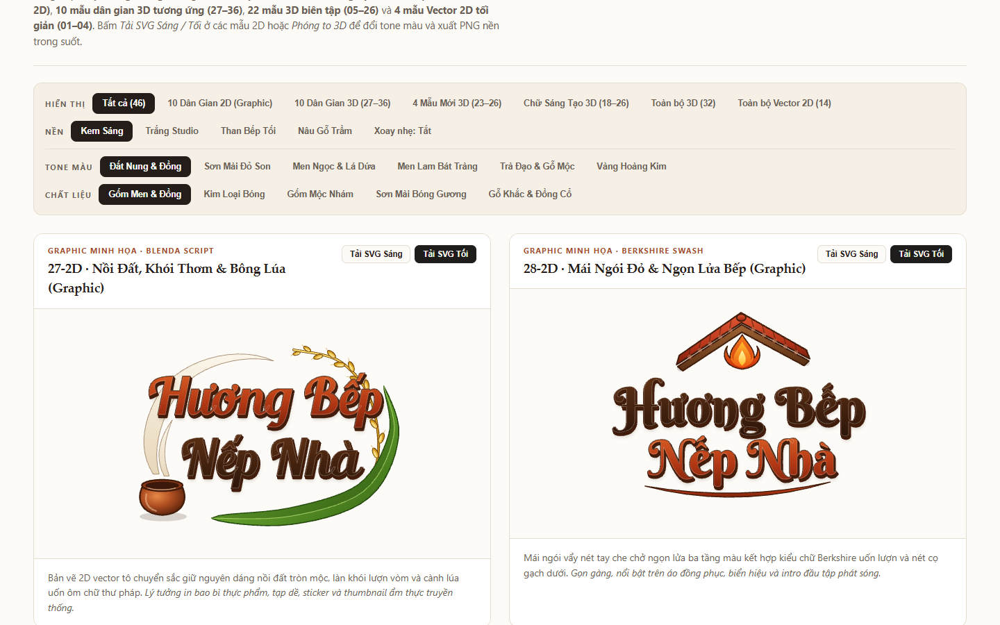

# Hương Bếp Nếp Nhà — Bộ Sưu Tập 46 Phương Án Logo

Bộ sưu tập trình diễn tương tác trực tiếp gồm 46 phương án logo (14 mẫu vector SVG 2D và 32 mẫu điêu khắc 3D thời gian thực bằng Three.js) cho chương trình ẩm thực – trò chuyện **Hương Bếp Nếp Nhà**.

[**Xem bản trực tuyến**](https://gati263.github.io/huong-bep-nep-nha-logo/) · [**Mã nguồn GitHub**](https://github.com/gati263/huong-bep-nep-nha-logo)



## Tính năng chính

- **46 phương án trong một file duy nhất:**
  - `10 Dân Gian 2D (Graphic)` (`27-2D` → `36-2D`): Minh họa vector 2D nồi đất, mẹt tre đan, bếp củi, mái ngói âm dương, ruy-băng gỗ và bông lúa.
  - `10 Dân Gian 3D` (`27` → `36`): Phiên bản dựng khối 3D PBR tương ứng với chuyển động khói ấm và ngọn lửa.
  - `Chữ Sáng Tạo & Biên Tập 3D` (`05` → `26`): Các biến thể typography 3D kết hợp biểu tượng bếp Việt trong nét chữ.
  - `Vector 2D tối giản` (`01` → `04`): Bộ nhận diện hình học phẳng dùng cho in ấn, favicon và đóng dấu góc màn hình.
- **Đổi nhanh diện mạo toàn bộ trang:** 4 chế độ nền (mặc định **Kem Sáng**, Trắng Studio, Than Bếp Tối, Nâu Gỗ Trầm), 6 tone màu tổng thể và 5 chất liệu bề mặt 3D (Gốm Men & Đồng, Kim Loại Bóng, Gốm Mộc Nhám, Sơn Mài Bóng Gương, Gỗ Khắc & Đồng Cổ).
- **Tương tác & xuất file:** Kéo chuột trực tiếp trên từng khung 3D để xoay góc nhìn, mở chế độ **Phóng to 3D** với `OrbitControls`, tải file **PNG 3D nền trong suốt (`2400×1350`)** hoặc tải trực tiếp từng file **SVG sáng/tối**.

## Kiến trúc kỹ thuật

- **Tự chứa hoàn toàn (Single-file static showcase):** Toàn bộ mã HTML/CSS/JavaScript, dữ liệu 28 file SVG (14 cặp sáng/tối đã chuyển chữ sang `<path>` + `<use>` nên không phụ thuộc font máy người xem) và hình học đa giác 3D cho 32 mẫu đều được nhúng gọn trong `index.html`.
- **Một ngữ cảnh WebGL cho cả lưới:** Toàn bộ 32 khung 3D dùng chung một `<canvas>` cố định kết hợp kỹ thuật `Scissor Test` của Three.js, giúp trình duyệt không bị vượt giới hạn số ngữ cảnh WebGL trên một trang.

## Chạy cục bộ

```bash
python -m http.server 4173 --bind 127.0.0.1
```

Sau đó mở trình duyệt tại `http://127.0.0.1:4173/`.

## Phụ thuộc mạng khi chạy

- Trang tải thư viện `three@0.170.0` và `OrbitControls` / `RoomEnvironment` từ CDN `https://unpkg.com/three@0.170.0/` thông qua `<script type="importmap">`. Cần kết nối Internet ở lần tải đầu tiên để hiển thị phần 3D; toàn bộ 14 cặp SVG 2D vẫn hiển thị độc lập không cần mạng ngoài.

## Cấu trúc thư mục

```text
huong-bep-nep-nha-logo/
├── index.html
├── assets/
│   └── preview.png
├── README.md
└── .gitignore
```

## Ghi chú bản quyền

Kho lưu trữ được mở công khai nhằm phục vụ việc xem trước, trình bày và chia sẻ bộ phương án thiết kế qua GitHub Pages. Chưa gắn giấy phép tái sử dụng mã nguồn mở riêng.
